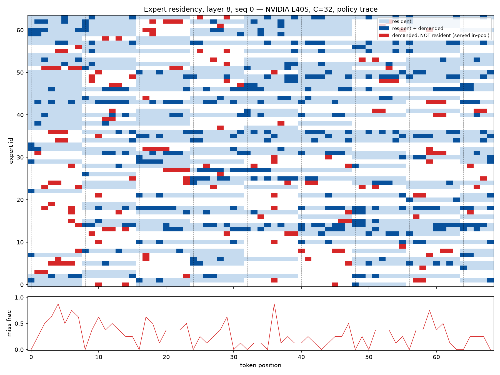

# Fewer Expert Transfers Without Changing Routing: Expert Eviction for MoE Offloading

Code, recorded traces and raw measurements for the paper by Pierre-Luc Bacon, Diego
Calanzone and Jean-Maxime Larouche (CarbonForge, Mila, Université de Montréal),
AXIOM workshop at NeurIPS 2026. Paper: [arXiv:2611.15842](https://arxiv.org/abs/2611.15842).

When the experts of a mixture-of-experts model do not all fit on the GPU, serving systems
keep the rest in CPU memory and copy an expert over whenever the router asks for one that
is missing. We measure this trade-off with real, timed CPU-to-GPU copies on a frozen
OLMoE-1B-7B, in which 8 of 16 MoE layers keep only 32 of their 64 experts on the GPU.

- Policies that hold one expert set fixed for several tokens copy fewer experts, but on an
  L40S every one of them that runs faster than LRU costs at least 0.067 nats of next-token
  loss.
- Changing only which expert the cache evicts keeps every routing decision intact.
  Evicting the expert whose next use lies farthest in the future cuts transfers by
  2.1× and is within 3.5% of the optimal schedule.
- Sixteen tokens of future demand recover 96% of that gain. A decayed-frequency rule that
  uses only past requests recovers 27%, and a learned scorer that also sees router
  probabilities recovers 32–33%.
- A learned termination controller and a router fine-tuned for simulated cache hits do
  not reduce the measured transfers.

## Quick start

Everything except the GPU harness runs on a laptop CPU.

```bash
make setup        # uv sync of the locked environment
make test         # 128 unit tests, no downloads
make reproduce    # rerun every offline analysis on data/ and compare with results/ (~1 min)
make figures      # regenerate paper/figures/*.pdf from results/
make paper        # build paper/main.pdf (needs a TeX installation with latexmk)
make arxiv        # build paper/arxiv.tar.gz for upload
```

`make reproduce` recomputes the farthest-future (Belady) bound, the replayed eviction
rules, the per-stream optimality bracket, the foresight curve, the dynamic-programming
check on 42,000 random instances, and the first imitation evictor (Appendices B–C). It
then checks 43 numbers against the files in `results/` and fails if any differs.
`make reproduce-all` also retrains the evictors that use router features (about 11
minutes on a laptop CPU).

## What is where

| Path | Contents |
|---|---|
| `paper/` | LaTeX source, bibliography, figures and `Makefile` |
| `src/moe_eviction/experiments/offload_wallclock.py` | the serving harness: real, blocking host-to-device copies timed with CUDA events |
| `src/moe_eviction/experiments/belady_*.py`, `evict_policies.py` | offline replay: oracle bound, optimality bracket, foresight curve, imitation evictors |
| `src/moe_eviction/models/` | trace collection, router and controller training, MMLU evaluation |
| `configs/` | one YAML file per recorded run (see the table below) |
| `jobs/` | Slurm wrappers used on the original cluster |
| `data/` | recorded per-token expert demand: the 16-sequence evaluation trace and the 48-sequence training trace (`data/README.md`) |
| `results/` | raw outputs behind each reported number |
| `artifacts/remoe_router_state.pt` | the reuse-biased router used in every recorded NLL row |
| `docs/CLAIMS.md` | each claim in the paper mapped to its evidence, including which claims rest on aggregate summaries only |
| `docs/EXPERIMENT_LOG.md` | the experiment log kept during the project (E1–E12) |

## Reproducing the GPU measurements

The harness needs a CUDA GPU with about 24 GB of memory and downloads OLMoE-1B-7B on first
use. Wall-clock numbers are only comparable on the same GPU and interconnect; all recorded
numbers come from one L40S (PCIe 4 ×16). A two-sequence smoke run, which also runs the
built-in exactness checks:

```bash
uv sync --locked --extra ml
uv run python -m moe_eviction.experiments.offload_wallclock \
  --config configs/offload_wallclock_smoke.yaml \
  --output-dir outputs/smoke \
  --router-state artifacts/remoe_router_state.pt
```

| Paper result | Config | Recorded output |
|---|---|---|
| Table 1, Figure 1 (native copy cost) | `offload_wallclock_e5a.yaml` | `results/e5a_frontier.jsonl` |
| Learned controller thresholds | `offload_wallclock_e5b.yaml` (needs trained heads, below) | `results/e5b_threshold_sweep.jsonl` |
| 10× and 50× copy cost | `offload_wallclock_tau10.yaml`, `offload_wallclock_tau50.yaml` | `results/tau10.jsonl`, `results/tau50.jsonl` |
| Replication shard | `offload_wallclock_e5c.yaml` | summary in `docs/EXPERIMENT_LOG.md` |
| Closed-loop eviction rules | `offload_wallclock_e6_evict.yaml` | summary in `docs/EXPERIMENT_LOG.md` |
| Demand traces in `data/` | `offload_wallclock_traceprobs16.yaml`, `offload_wallclock_traceprobs48.yaml` | `data/*.npz` |
| τ across GPUs | `python -m moe_eviction.experiments.bench_copy_paths` on each GPU | summary in `docs/EXPERIMENT_LOG.md` |
| Router fine-tuned for cache hits (Appendix E) | `workingset_*.yaml`, run with no `--router-state` | `results/e7_workingset_*.jsonl` |
| Controller trained with priced traffic (Appendix D) | `bestpool_train_big_s0_price{low,mid,high}.yaml` | `results/e12_eval_price*.jsonl` |
| MMLU (Appendix D) | `mmlu5k_{oracle,causal,learned}.yaml` | summary in `docs/EXPERIMENT_LOG.md` |

The learned-controller rows need the termination and selection heads, passed with
`--learned-beta-state` and `--policy-head-state`. The trained heads are not in this
repository; train them with `python -m moe_eviction.models.train_learned_beta` and
`configs/bestpool_train_big_s{0,1,2}.yaml` (three seeds). The models of Appendix E are
LoRA adapters merged into OLMoE-1B-7B-0125-Instruct with
`scripts/merge_workingset_adapters.py`. These models carry their own fine-tuned router,
so run them without `--router-state`; with the Slurm wrapper, set `ROUTER_STATE=""`.

On a Slurm cluster, `jobs/submit_*.sh` submits the matching `jobs/run_*.sh`, for example
`CONFIG=configs/offload_wallclock_e5a.yaml jobs/submit_offload_wallclock.sh`. The wrappers
assume `$SCRATCH` and the Mila module setup in `jobs/_mila_env.sh`; adapt that file to
your cluster.

## Implementation notes

The harness is plain PyTorch on Hugging Face Transformers, and nothing in either library
is patched. Each OLMoE decoder layer calls `hidden = self.mlp(hidden)`, so replacing the
`mlp` attribute of the eight restricted layers with our block is the whole integration.
The model's own forward pass then calls our code in the middle of the network, which makes
every policy decision closed-loop: layer 4 decides using its real hidden state before
layers 5–15 run. We did not build on a serving framework because per-token policies
written in Python conflict with graph-captured runtimes, and because the eager path lets
the exactness checks compare against the unmodified computation. The open vLLM expert
cache ([vllm-project/vllm#37190](https://github.com/vllm-project/vllm/pull/37190)) uses
the same design: pinned host weights, a fixed GPU cache and per-token admission. Its
discussion reports 35.1 tokens/s in eager mode on this model, near our LRU arm's 38.3,
on different hardware and with a different protocol.

Evicting an expert moves no data. Each layer's pool is a set of GPU slots and an ordered
map on the host from expert id to slot, in order of last use. Eviction removes a map
entry, and the incoming expert's copy overwrites the freed slot. Copies and expert matrix
multiplications are queued on the same CUDA stream, so no other synchronization is needed
except for timing. A new eviction rule is therefore one function that picks the victim;
slot reuse, transfer counting and the exactness checks stay unchanged.

The figure below (dwell-8, layer 8, sequence 0) shows how a policy that holds a fixed set
substitutes experts. Light rows are resident experts, dark cells are requested experts
that were resident, red cells are requested experts that were not resident (the masked
router chose another expert instead), and dashed lines are refreshes. The lower panel is
the fraction of each token's requests that fell outside the pool. It was produced by
`python -m moe_eviction.experiments.plot_residency <run_dir>` on a harness run with
`residency_trace_dwell: 8` in the `eval` section of its config, as in `configs/offload_wallclock_e5a.yaml`.



## Citation

```bibtex
@inproceedings{bacon2026expert,
  title     = {Fewer Expert Transfers Without Changing Routing: Expert Eviction for {MoE} Offloading},
  author    = {Bacon, Pierre-Luc and Calanzone, Diego and Larouche, Jean-Maxime},
  booktitle = {AXIOM: Foundations of Efficient Deep Learning, NeurIPS 2026 Workshop},
  year      = {2026},
  eprint    = {2611.15842},
  archivePrefix = {arXiv},
  primaryClass  = {cs.LG},
  url       = {https://arxiv.org/abs/2611.15842}
}
```

## License

Apache 2.0. See `LICENSE`.
